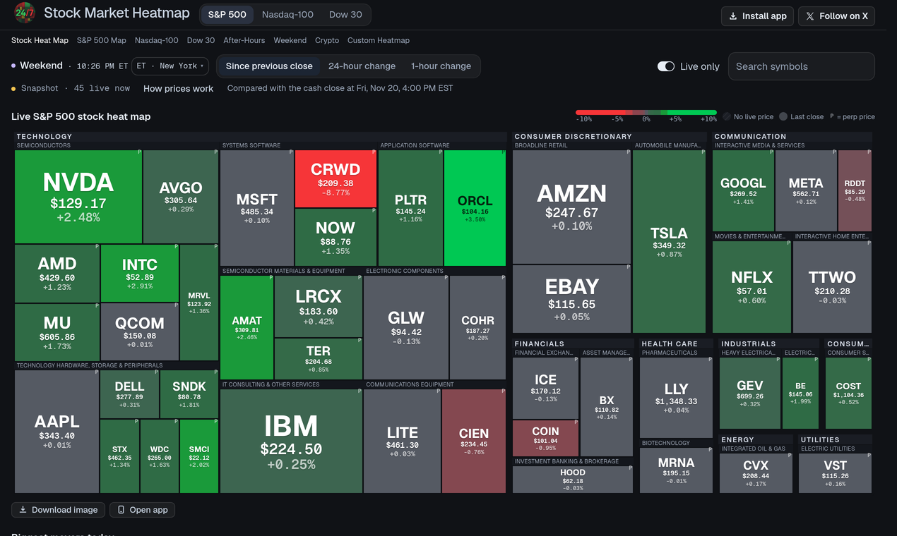
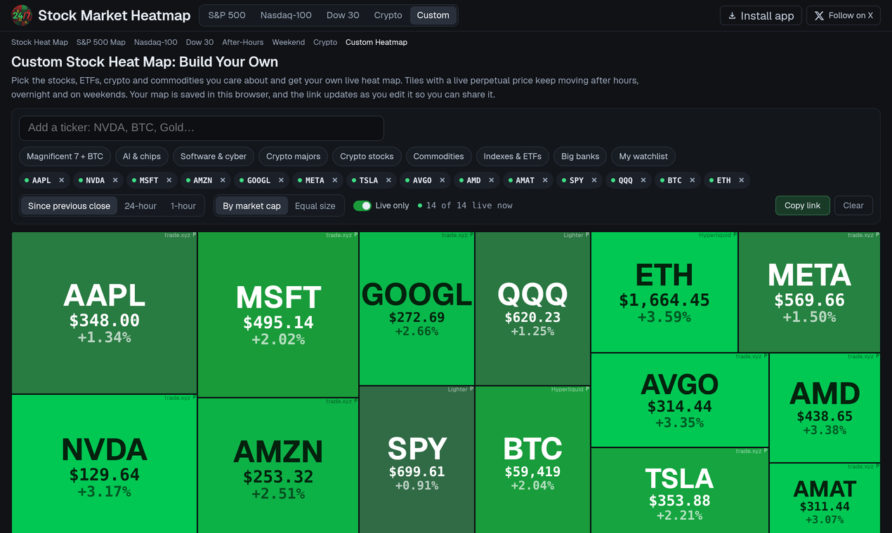

# 247heatmap-widget

[](LICENSE)
[](https://247heatmap.com/embed/)
[](https://247heatmap.com/)

Free, zero-API-key widget for a live 24/7 stock, ETF, and crypto heatmap. Drop in a plain HTML iframe, the `<heatmap-247>` web component, or the React component. Quotes are served by [247heatmap.com](https://247heatmap.com/) — no key, no account, no backend of your own.

Tiles show the ticker, price, and percent move. Index maps keep updating after hours, overnight, and on weekends using 24/7 perpetual futures prices. A custom map can mix S&amp;P 500 names with ETFs, crypto, commodities, and FX.

- [Live embed configurator](https://247heatmap.com/embed/)
- [Custom watchlist builder](https://247heatmap.com/custom/)
- [55-second walkthrough](https://youtu.be/7zjK4HleVu8)
- [Live site](https://247heatmap.com/)



*S&amp;P 500 heatmap on 247heatmap.com. Larger tiles are larger companies. Green is up since the previous close, red is down.*



*Custom watchlist at [247heatmap.com/custom/](https://247heatmap.com/custom/). The same tickers can be embedded with `map="custom"`.*

## Install

```bash
npm install 247heatmap-widget
```

React is an optional peer dependency. HTML and web-component users do not install it. The package has no runtime dependencies.

## Plain HTML

Paste an iframe. The official snippets from the [embed configurator](https://247heatmap.com/embed/) look like this.

Dark:

```html
<iframe src="https://247heatmap.com/embed/sp500/dark/" width="100%" height="480" style="border:0;min-height:360px;background:#101216;" title="S&P 500 heat map — 24/7 Heatmap" loading="lazy"></iframe>
<p style="margin:6px 0 0;font:12px/1.4 system-ui,-apple-system,Segoe UI,sans-serif;color:#9aa6b8;">
  Live market map by <a href="https://247heatmap.com/" target="_blank" rel="noopener">247heatmap.com</a>
</p>
```

Light. The configurator's copy button uses `background:#101216` on this snippet too. The light map's own canvas is `#f4f6f8`, so the frame below uses that and does not flash black while the map loads:

```html
<iframe src="https://247heatmap.com/embed/sp500/light/" width="100%" height="480" style="border:0;min-height:360px;background:#f4f6f8;" title="S&P 500 heat map — 24/7 Heatmap" loading="lazy"></iframe>
<p style="margin:6px 0 0;font:12px/1.4 system-ui,-apple-system,Segoe UI,sans-serif;color:#5b6673;">
  Live market map by <a href="https://247heatmap.com/" target="_blank" rel="noopener">247heatmap.com</a>
</p>
```

Nasdaq-100, Dow 30, and Live only (`?live=1` hides tiles that do not have a live price):

```html
<iframe src="https://247heatmap.com/embed/nasdaq-100/dark/" width="100%" height="480" style="border:0;min-height:360px;background:#101216;" title="Nasdaq-100 heat map — 24/7 Heatmap" loading="lazy"></iframe>
<iframe src="https://247heatmap.com/embed/dow-30/light/" width="100%" height="480" style="border:0;min-height:360px;background:#f4f6f8;" title="Dow 30 heat map — 24/7 Heatmap" loading="lazy"></iframe>
<iframe src="https://247heatmap.com/embed/sp500/dark/?live=1" width="100%" height="480" style="border:0;min-height:360px;background:#101216;" title="S&P 500 heat map — 24/7 Heatmap" loading="lazy"></iframe>
```

Custom watchlist. Build it on [247heatmap.com/custom/](https://247heatmap.com/custom/), or write the tickers yourself. `t` is the ticker list. `m=24h` or `m=1h` changes the color basis (omit `m` for the move since the previous close). `s=equal` makes every tile the same size (omit `s` to size by market cap).

```html
<iframe src="https://247heatmap.com/embed/custom/?t=NVDA,AAPL,MSFT,GOOGL,BTC,ETH" width="100%" height="480" style="border:0;min-height:360px;background:#101216;" title="Custom stock heat map — 24/7 Heatmap" loading="lazy"></iframe>
<iframe src="https://247heatmap.com/embed/custom/?t=NVDA,AAPL,BTC&m=24h&s=equal&live=1" width="100%" height="480" style="border:0;min-height:360px;background:#101216;" title="Custom stock heat map — 24/7 Heatmap" loading="lazy"></iframe>
```

The paragraph under the iframe is an optional host-page credit. Delete it if you need to. Please leave the small “Powered by 247heatmap” link that already ships inside the iframe — that link is part of the hosted map.

Other index URLs: `https://247heatmap.com/embed/nasdaq-100/light/` and `https://247heatmap.com/embed/dow-30/dark/`.

## Web component

```html
<script src="https://unpkg.com/247heatmap-widget@1.0.0/dist/heatmap-247.iife.js"></script>
<heatmap-247 map="sp500" theme="dark" height="480px"></heatmap-247>
<heatmap-247 map="nasdaq-100" theme="light" height="480px"></heatmap-247>
<heatmap-247 map="custom" tickers="NVDA,AAPL,MSFT,BTC,ETH" live="true"></heatmap-247>
<heatmap-247 map="dow-30" attribution="false"></heatmap-247>
```

From the package:

```js
import "247heatmap-widget/web-component";
```

`<heatmap-247>` registers itself. Importing the module twice is safe: it checks `customElements.get` before calling `define`. In Node or during server rendering, `customElements` is missing and the module does nothing.

Open `examples/index.html` after `npm run build` for a side-by-side demo of dark and light iframes and the web component.

## React and Next.js

```tsx
import { StockHeatmap } from "247heatmap-widget/react";

export default function Page() {
  return (
    <StockHeatmap map="sp500" theme="dark" height={480} live />
  );
}
```

`Heatmap247` is the same component:

```tsx
import { Heatmap247 } from "247heatmap-widget/react";

<Heatmap247 map="custom" tickers={["NVDA", "AAPL", "MSFT", "BTC", "ETH"]} attribution={false} />
```

`tickers` is only sent for `map="custom"`. On an index map it is ignored, because those routes have no ticker query.

The component renders an `<iframe>` and does not read `window`, so it works in the Next.js App Router without `dynamic(..., { ssr: false })`. Use the web component from a client component if you prefer the custom element:

```tsx
"use client";
import "247heatmap-widget/web-component";

export function Map() {
  return <heatmap-247 map="nasdaq-100" theme="dark" height="480px"></heatmap-247>;
}
```

## WordPress, Ghost, Webflow, and Notion

**WordPress.** Add a Custom HTML block and paste an iframe from above. Editors who cannot publish iframes can use the Embed block with a bare URL such as `https://247heatmap.com/embed/sp500/dark/`. For the web component, enqueue `heatmap-247.iife.js` from your theme and put `<heatmap-247>` in a Custom HTML block.

**Ghost.** Use an HTML card and paste the iframe. The same card can hold the script tag and `<heatmap-247>`.

**Webflow.** Add an Embed element and paste the iframe. To use the custom element, put the script in Project Settings → Custom Code before `</body>`, then add `<heatmap-247 map="sp500" theme="dark" height="480px"></heatmap-247>` in an Embed element.

**Notion.** Type `/embed` and paste the iframe URL, for example `https://247heatmap.com/embed/nasdaq-100/dark/`. Notion embeds by URL and does not run custom elements. Add the attribution sentence as a line of text under the embed if you want it on the page.

## Props and attributes

| Name | Default | What it does |
| --- | --- | --- |
| `map` | `"sp500"` | `sp500`, `nasdaq-100`, `dow-30`, or `custom`. Aliases `nasdaq`, `ndx`, `dow`, `djia`, and `spx` map to those routes. Anything else falls back to `sp500` so the iframe does not 404. |
| `theme` | `"dark"` | `dark` or `light`. Index URLs are `/embed/{map}/{theme}/`. Custom embeds stay on `/embed/custom/` — `/embed/custom/light/` is not a production route. |
| `height` | `"480px"` | Iframe height. A number is pixels. |
| `width` | `"100%"` | Iframe width. A number is pixels. |
| `tickers` | empty | Custom maps only. Comma- or space-separated symbols, uppercased, capped at 60. Written as `?t=NVDA,AAPL,BTC`. |
| `live` | off | Adds `?live=1`, the Live only switch from the embed configurator. |
| `metric` | `"close"` | Custom maps only. `24h` or `1h` adds `m`. `close` (move since the previous close) is omitted, matching the Embed this map button. |
| `size` | `"cap"` | Custom maps only. `equal` adds `s=equal`. Market-cap sizing is omitted. |
| `attribution` | on | Host-page line: Live market map by [247heatmap.com](https://247heatmap.com/). Set `attribution="false"` or `attribution={false}` to remove that line. |
| `title` | per map | Accessible iframe title. Defaults to the production title, such as `S&P 500 heat map — 24/7 Heatmap`. |
| `className`, `style` | — | React only. Applied to the wrapper around the iframe. |

`buildEmbedUrl()` is exported from the package root for callers that only need the iframe address.

## Verified routes

Checked against production HTML on 24 November 2026. `curl` from a datacenter IP receives a Cloudflare challenge, so the routes below were taken from the live page source, including each `Heatmap247.mount(...)` call and the custom page’s Embed this map builder.

| Page | URL |
| --- | --- |
| Configurator | https://247heatmap.com/embed/ |
| S&amp;P 500 dark | https://247heatmap.com/embed/sp500/dark/ |
| S&amp;P 500 light | https://247heatmap.com/embed/sp500/light/ |
| Nasdaq-100 dark | https://247heatmap.com/embed/nasdaq-100/dark/ |
| Nasdaq-100 light | https://247heatmap.com/embed/nasdaq-100/light/ |
| Dow 30 dark | https://247heatmap.com/embed/dow-30/dark/ |
| Dow 30 light | https://247heatmap.com/embed/dow-30/light/ |
| Custom | https://247heatmap.com/embed/custom/?t=NVDA,AAPL,BTC |
| Full crypto map (not an embed) | https://247heatmap.com/crypto/ |

`?live=1` works on every embed above. Custom maps also accept `t`, `m` (`24h` or `1h`), and `s` (`equal`).

These paths are not embed routes: `/embed/custom/dark/`, `/embed/custom/light/`, `/embed/crypto/dark/`, `/embed/crypto/light/`. Crypto symbols such as `BTC` and `ETH` go on the custom embed. The full top-100 crypto heatmap is the page at `/crypto/`, not an iframe.

Index mount options, from the embed pages:

```js
Heatmap247.mount("#hm", { index: "sp500", theme: "dark", liveOnly: /[?&]live=1/.test(location.search) });
Heatmap247.mount("#hm", { index: "nasdaq100", theme: "light", liveOnly: /[?&]live=1/.test(location.search) });
Heatmap247.mount("#hm", { index: "dow30", theme: "dark", liveOnly: /[?&]live=1/.test(location.search) });
```

## Development

```bash
npm install
npm run check
```

`npm run check` typechecks, builds ESM, CommonJS, IIFE, and `.d.ts`, then runs the unit tests. Tests cover every map, theme, and attribution combination, the custom query string, and server rendering without `window`.

| Path | Role |
| --- | --- |
| `src/embed-url.ts` | URL builder shared by every wrapper |
| `src/web-component.ts` | `<heatmap-247>` |
| `src/react.tsx` | `StockHeatmap` / `Heatmap247` |
| `dist/heatmap-247.iife.js` | Browser bundle |
| `examples/index.html` | Demo page |

## License and links

MIT License. Copyright (c) 2026 247heatmap.com.

[X](https://x.com/247heatmap) · [YouTube](https://www.youtube.com/@247heatmap) · [247heatmap.com](https://247heatmap.com/)

24/7 Heatmap is for information only and is not investment, financial, or trading advice. Prices can be delayed or differ from the cash market, especially overnight and on weekends, when a tile may show a perpetual futures price.
